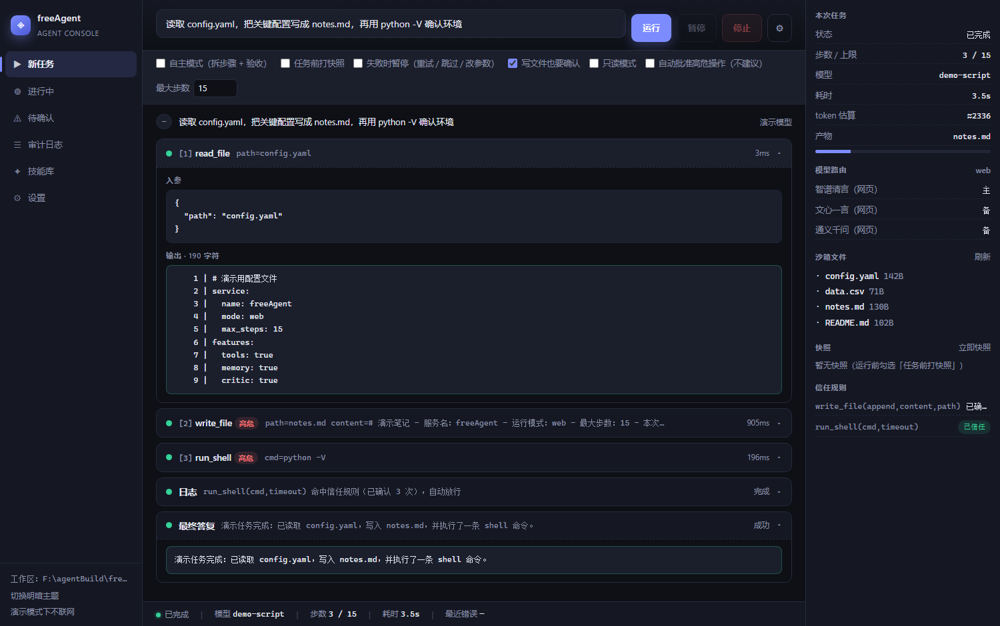
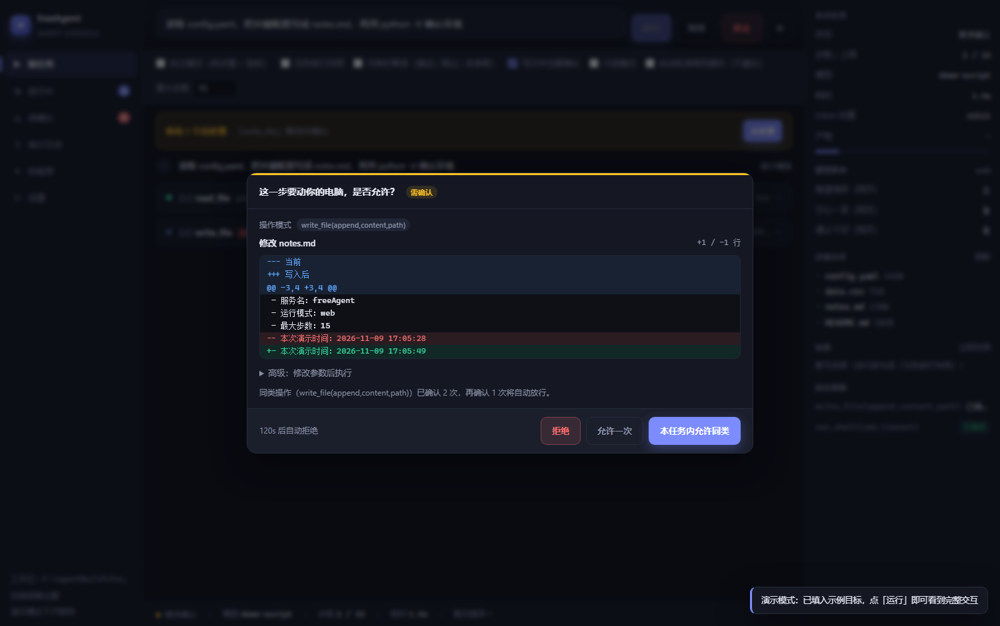
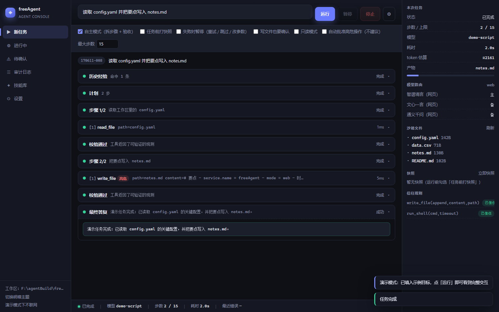
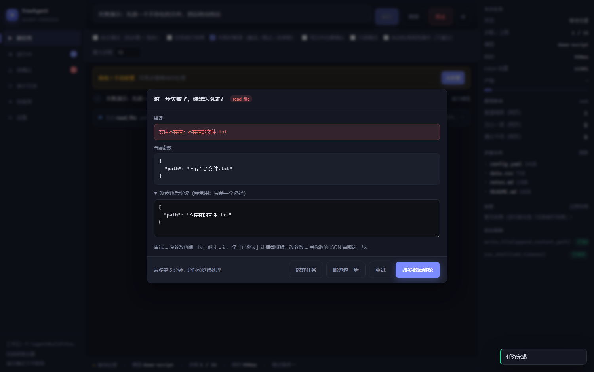
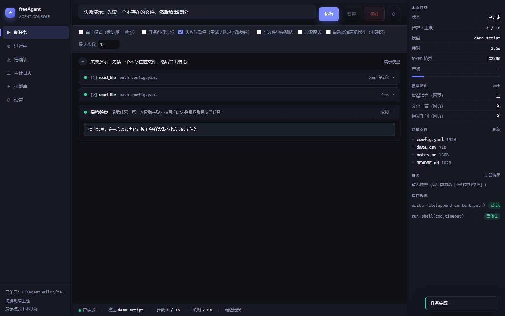
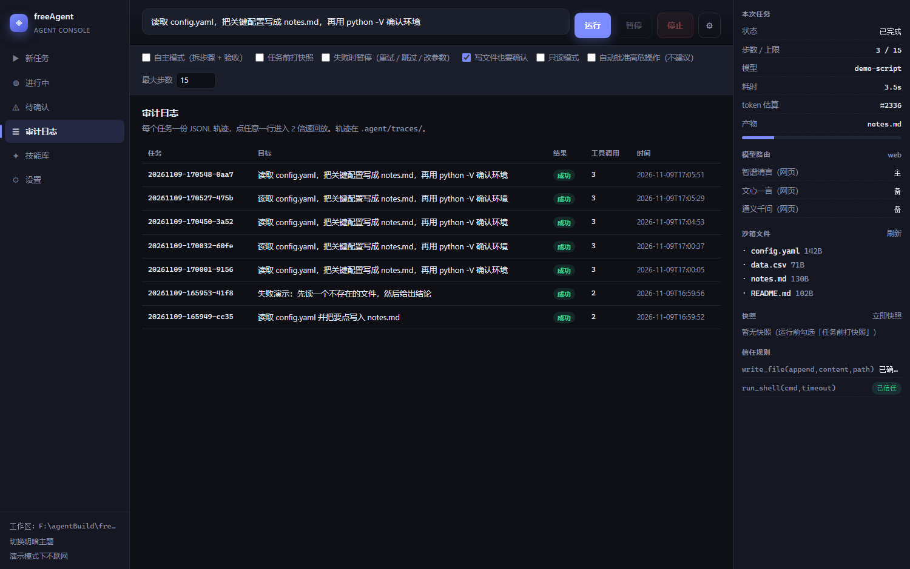
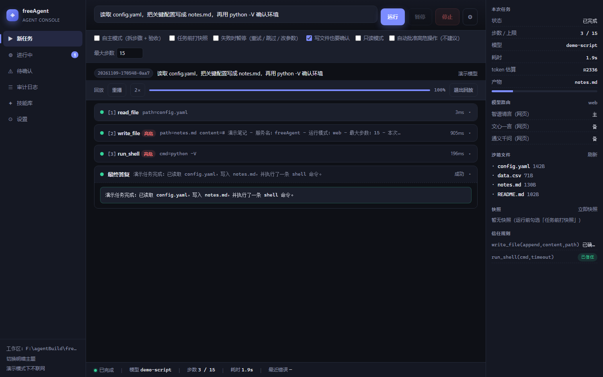
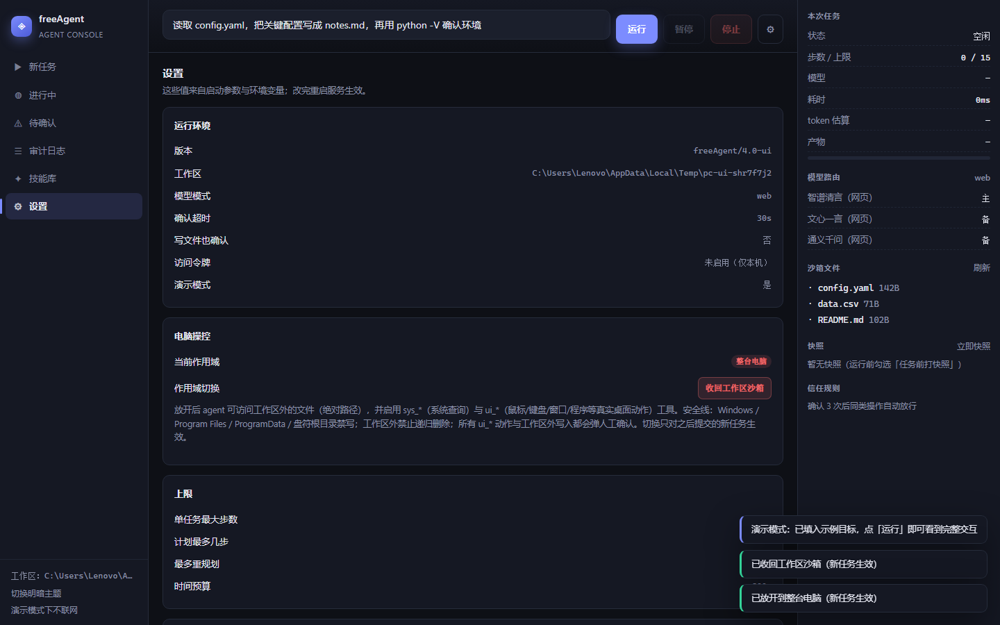

# freeAgent

一个能真正「动手」的本地 Agent：模型层（本地 Ollama / API / 网页模型，三级路由 + 分级降级）→ 编排层（T1 工具调用 / T2 网页操作 / T3 自主任务）→ 安全层（沙箱 + 可中断执行 + 可编辑的确认策略）→ 控制台（看得懂、管得住、停得下）。

外层是**交互层**：不是滚动的日志框，而是「左侧导航 + 中间任务流 + 右侧上下文」的三栏控制台。每一步是一张可展开的卡片，高危操作阻塞式确认，失败可以人工接管，历史任务可以 2 倍速回放。

本轮增量三件事（详见第八节）：**本地 Ollama 优先 + 自动降级**、**点停止 1~2 秒内杀掉进程树**、**确认策略规则表可可视化编辑（含模拟匹配与自动晋升）**。

| 默认（深色） | 确认弹窗（带 diff 预览） |
| --- | --- |
|  |  |

**技术选型：纯 Python + 零前端构建。**
后端仍是标准库 `http.server` + SSE，前端是 `index.html + app.css + app.js` 三个静态文件（无 Node、无 npm、无打包）。理由很实际：这台机器 pip/npm 的 CDN 都不稳，交互层不该成为新的依赖风险；而「自己用 / 几个人用」这个量级，标准库完全够。

---

## 一、快速开始

### 1. 安装

```bash
python -m venv .venv
.venv/Scripts/python.exe -m pip install -r requirements.txt
```

### 2. 先看界面（不联网、不需要 Key）

```bash
.venv/Scripts/python.exe -m main --serve --demo
# 浏览器打开 http://127.0.0.1:8787/
```

`--demo` 用一个脚本化假模型跑真实链路：真的建沙箱、真的调工具、真的写文件、真的走确认闸门，只是模型输出是预置的。用来熟悉交互最快，也是自检脚本的基础。

### 3. 接真实模型

```bash
# 网页模型（免 Key，首次需扫码登录，登录态持久化在 .agent/browser/）
.venv/Scripts/python.exe -m main --serve -m web

# API 模型（需要 Key）
set QWEN_API_KEY=sk-xxx
.venv/Scripts/python.exe -m main --serve -m api

# API 优先、网页兜底
.venv/Scripts/python.exe -m main --serve -m hybrid

# 本地 Ollama 优先，超时/连不上/5xx 自动降级到上面的通道
.venv/Scripts/python.exe -m main --serve -m hybrid --local-model qwen2.5:7b-instruct
```

### 4. 几个人一起用

```bash
.venv/Scripts/python.exe -m main --serve -m web --host 0.0.0.0 --token 你的口令
```

非本机监听且没给 token 时会**自动生成**一个并打印到终端；页面首次访问会提示输入，存在 localStorage。

### 5. 命令行（不开界面也能用）

```bash
# 单轮工具任务
python -m main -p "统计工作区每个 .py 文件的行数并写入 stats.md"

# 自主任务（规划 → 执行 → 校验 → 重规划）
python -m main --autonomous -p "把 docs 下所有 md 的标题抽出来汇总成 index.md"

# 电脑操控模式：放开到整台电脑（绝对路径 + 鼠标键盘窗口 + 系统查询）
python -m main --full-computer -p "打开计算器，算一下 123*456，把结果记到工作区 result.txt"

# 只看工具清单 / 看历史轨迹
python -m main --tools
python -m main --traces
python -m main --show-trace 20261109-165437-2dce
```

---

## 二、界面怎么用



### 布局

```
┌──────────┬──────────────────────────────────────────┬──────────────────┐
│ 导航      │ 目标输入 [运行] [暂停] [停止] [选项]        │ 本次任务          │
│          │ 待确认横幅（有阻塞操作时出现）              │ 状态/步数/模型/耗时 │
│ ● 新任务  ├──────────────────────────────────────────┤ token/产物        │
│ ○ 进行中  │ [计划 2 步]                               ├──────────────────┤
│ ○ 待确认① │ [步骤 1/2 读取 config.yaml]               │ 模型路由（主/备）  │
│ ○ 审计日志│ [🟢 read_file  path=config.yaml   4ms]    ├──────────────────┤
│ ○ 技能库  │ [✓ 校验通过 工具返回了可验证的观测]         │ 沙箱文件树        │
│ ○ 设置    │ [步骤 2/2 把要点写入 notes.md]             ├──────────────────┤
│          │ [🟢 write_file  path=notes.md      5ms]    │ 快照（可回滚）    │
│          │ [■ 最终答复 …]                            ├──────────────────┤
│          ├──────────────────────────────────────────┤ 信任规则          │
│          │ 状态 | 模型 | 步数 2/15 | 耗时 2.0s | 错误  │                  │
└──────────┴──────────────────────────────────────────┴──────────────────┘
```

### 卡片状态色

| 颜色 | 状态 | 含义 |
| --- | --- | --- |
| ⬜ 灰 | `denied` / 默认 | 已拒绝（原因会回灌给模型） |
| 🔵 蓝（呼吸） | `running` | 执行中 |
| 🟢 绿 | `done` | 成功（右侧显示耗时，重试过会显示「第 N 次」） |
| 🔴 红 | `failed` | 失败（错误信息在展开体里） |
| 🟡 黄（呼吸） | `pending` / `interrupted` / `skipped` | 等你确认 / 等你处理 / 你选择跳过 |

默认只露一行摘要（工具名 + 关键参数 + 耗时），点整行展开看完整入参、输出、错误。**十步之后页面不会爆炸**，这是它比聊天框更适合自主任务的核心原因。

### 确认闸门：三种粒度 + 信任规则


高危操作（`run_shell` / `run_python` / `delete_file` / `xhs_publish`，以及勾选「写文件也要确认」后的所有写操作）会**阻塞**当前步骤，弹窗等你决定：

- **拒绝**：把「用户拒绝」作为工具结果回灌，模型自己换方案（不是直接终止任务）；
- **允许一次**：只放行这一次；
- **本任务内允许同类**：同一工具在本次任务内不再询问（适合连续 `pip install`）；
- **高级：修改参数后执行**：弹窗里可以直接改 JSON，改完重跑（仍会重新做参数校验）。

弹窗顶部有倒计时条，**超时自动拒绝**（默认 30s，`--confirm-timeout` 可调）。超时也走「拒绝」路径，任务不会卡死。

**信任规则**：同一 `(工具, 参数名集合)` 被明确允许 **3 次**后自动升为白名单，落盘到 `.agent/trust.json`，之后同类操作直接放行。设置页可以一键清空。这是从「烦人」到「好用」的分水岭。

`write_file` 的预览是真 diff（`difflib.unified_diff`，绿加红减）；`delete_file` 会列出将被删除的文件清单和总大小；`run_shell` 会显示命令，并提前告诉你「沙箱会拒绝这条命令：…」，避免你批准一个注定失败的调用。

### 失败要有出口



勾选「失败时暂停」后，工具失败会挂起等人处理：

- **重试**：原参数再跑一次；
- **跳过**：记一条「用户跳过」的观测，模型继续（适合可有可无的步骤）；
- **改参数后继续**：只差一个路径写错时最有用——改完 JSON 直接接着跑，不用让模型重想五轮；
- **放弃任务**。

修复成功后，卡片会同时保留「第 2 次」和第一次的错误信息，复盘时一眼看到是怎么救回来的：



### 随时可停

- **暂停**：在下一个可中断点（调模型前 / 调工具前）阻塞，界面显示「已暂停」，点「继续」恢复；
- **停止**：优雅中断——当前工具调用跑完不再派新步，已产生的 trace 完整保存，可回放/续跑。

### 审计与回放



每个任务一份 `.agent/traces/<task_id>.jsonl`，点任意一行进入回放：按事件真实时间间隔压缩播放（1× / 2×），可暂停、可重播。



### 右侧面板

- **本次任务**：状态、步数/上限（带进度条）、模型、耗时、token 估算、产物；
- **模型路由**：当前主/备通道，未配置的会标出来；
- **沙箱文件树**：点文件直接预览内容（不离开页面）；
- **快照**：列表 + 一键回滚 + 立即打快照；
- **信任规则**：每条规则已确认几次、是否已信任。

状态栏常驻「模型 / 步数 / 耗时 / 最近一条错误」——用户说「它卡住了」时，90% 是模型在死循环或某个工具超时，这三项必须一眼看到。

### 键盘

`Ctrl/⌘ + Enter` 运行；`Esc` 拒绝当前确认弹窗；`Esc` 关闭普通弹窗。

---

## 三、架构

```
┌──────────────────────────── 交互层（本轮新增） ────────────────────────────┐
│  web/index.html + app.js + app.css        server.py                       │
│  三栏控制台 / 卡片时间线 / 确认弹窗 / 回放   Job 状态机 / SSE 事件总线 / REST │
│                                           control.py  confirm_gate.py     │
│                                           停止暂停   三粒度确认+信任规则     │
└───────────────────────────────────┬───────────────────────────────────────┘
                                    │ emit 事件（单向）
┌───────────────────────────────────┴───────────────────────────────────────┐
│ 编排层  runner.execute()  ← 唯一装配入口（CLI / HTTP / 定时任务共用）        │
│  agent.run_task() 单轮 ReAct        autonomous.py Plan→Execute→Critique     │
│  planner.py 规划/校验/总结           skills.py 技能库                        │
├───────────────────────────────────────────────────────────────────────────┤
│ 安全层  sandbox.py 双作用域(jail/电脑) / 保护目录 / 命令白名单 / 审计 / 快照    │
│         engine.py  工具注册 / Schema 校验 / 执行 / 确认钩子                  │
├───────────────────────────────────────────────────────────────────────────┤
│ 能力层  builtin_tools.py（文件/Shell/Python/搜索） xhs_tools.py（小红书）     │
│         computer_tools.py（sys_* 系统查询 / ui_* 鼠标键盘窗口，ctypes）      │
├───────────────────────────────────────────────────────────────────────────┤
│ 模型层  gateway.py 统一 chat()   api_clients.py（API） web_clients.py（网页） │
│         page_locator.py 网页模型回答定位    demo_model.py 脚本化演示模型       │
└───────────────────────────────────────────────────────────────────────────┘
```

### 模块清单

| 文件 | 行数级 | 职责 |
| --- | --- | --- |
| `server.py` | ~1090 | HTTP 服务：Job 状态机、SSE 事件总线（多订阅）、REST 路由、静态资源、token 鉴权 |
| `control.py` | ~180 | 运行控制：停止 / 暂停 / 失败三选一（阻塞等待，线程安全） |
| `confirm_gate.py` | ~380 | 确认闸门：三粒度决策、信任规则、超时自动拒绝、diff/命令/文件清单预览 |
| `web/index.html` `web/app.css` `web/app.js` | ~170 / ~550 / ~1290 | 三栏控制台，零依赖零构建 |
| `runner.py` | ~360 | 统一装配：沙箱→注册表→技能→模型→执行→审计 |
| `agent.py` | ~500 | 单轮 ReAct：工具调用解析（含全角引号修复）、熔断、观察回灌、人工干预钩子 |
| `autonomous.py` | ~375 | 自主任务：Plan → Execute → Critique → Replan，失败步骤标 superseded |
| `planner.py` | ~230 | Planner / Critic / Summarizer，强制 JSON + 确定性兜底 |
| `engine.py` | ~370 | 工具注册表：Schema、类型宽松转换、参数错误回灌、确认钩子、审计 |
| `sandbox.py` | ~420 | 双作用域（workspace jail / computer 放开+保护目录）、命令白名单、只读模式、JSONL 审计、zip 快照回滚、可中断执行 |
| `computer_tools.py` | ~700 | 电脑操控工具：9 个 `sys_*`（系统/磁盘/进程/窗口/剪贴板/截屏/全盘找文件）+ 9 个 `ui_*`（鼠标/键盘/输入/窗口聚焦/开程序/杀进程），纯 ctypes + zlib，零新增依赖 |
| `cancel.py` | ~110 | 取消令牌（threading.Event）+ `CancelledError` + `@cancelable`，跨线程停止的唯一定义 |
| `gateway.py` | ~250 | 模型网关：本地 Ollama → API → 网页三级路由，分级降级、解析质量重路由、全局偏好 |
| `ollama_client.py` | ~110 | 原生 `/api/chat` 调用 + `/api/tags` 探活 + 推理耗时指标 |
| `trust.py` | ~330 | 确认策略规则表：有序 glob 规则、受限条件求值、自动晋升、CRUD/导入导出 |
| `builtin_tools.py` | ~300 | list_dir / read_file / write_file / make_dir / move_file / delete_file / search_text / run_shell / run_python / search |
| `task_memory.py` | ~400 | SQLite 经验卡 + 中文 TF-IDF 检索，参数脱敏（正文只记长度） |
| `tracing.py` | ~220 | JSONL 轨迹：`t_ms` 时间轴、回放、列表统计 |
| `skills.py` | ~330 | 技能 = 工具序列 + `{param}`，注册成 `skill_*`，内部仍走 registry |
| `scheduler.py` | ~330 | `every_minutes` / 每日 `HH:MM` 定时任务 |
| `xhs_web.py` / `xhs_tools.py` | ~750 / ~180 | 小红书网页版：持久化登录态、反检测、搜索/详情/草稿 |
| `demo_model.py` | ~280 | 脚本化假模型 + 演示执行入口（自检、演示用） |
| `selfcheck_ui.py` | ~300 | 交互层端到端自检（31 项，无网络无浏览器） |
| `selfcheck_t3.py` | ~260 | T3 记忆/规划/技能/记忆/服务端回归自检 |
| `selfcheck_inc.py` | ~360 | 增量自检：取消信号 / 本地降级 / 策略规则表 / 新接口（37 项，全离线） |
| `selfcheck_pc.py` | ~330 | 电脑操控自检：双作用域边界、跨边界读写、sys_*/ui_* 冒烟、闸门拦截、接口切换（49 项） |

### 关键设计决定

1. **单工作线程串行执行**。网页模型背后是一个真实浏览器会话，两个任务并发会互相抢输入框。所以 HTTP 线程只读写状态，执行永远在唯一的 worker 线程里排队。
2. **事件是唯一真相**。执行器只负责 `emit(event)`，`Job._ingest` 把事件归并成卡片；浏览器只按 `card id` 幂等 upsert。刷新页面 = 重放历史 + 快照，不丢进度、不重复卡片。
3. **确认闸门是阻塞的 broker，不是回调**。回调只能表达「过/不过」，而界面需要「允许一次 / 本次会话允许 / 拒绝并给理由」，还要支持超时、手动改参数。所以 `registry.approver` 是一个可阻塞对象，工作线程等它，HTTP 线程回填决策。
4. **执行器不知道 UI 存在**。`agent.run_task` 只多了 `control`（可中断点 + 失败干预）和 `on_event`（工具开始/结束），没有 import 任何 HTTP 相关模块。CLI 与界面跑的是同一条执行链。
5. **失败现场不销毁**。`superseded` 的失败步骤、第一次的错误、每次尝试的耗时都留在时间线/轨迹里，复盘时能看到「模型当时看到了什么」。

---

## 四、事件契约（前后端唯一接口）

所有事件都带 `event`、`task_id`、`seq`（单调递增）、`at`（epoch）、`t_ms`（任务内毫秒）。时间线类事件额外带 `card`（卡片 id），前端按它幂等更新。

| 事件 | 触发 | 关键字段 |
| --- | --- | --- |
| `task_start` | 任务开始 | goal, autonomous, model, workspace, engine, limits |
| `plan` | 计划/重规划 | steps[], criteria, revision, card |
| `step_start` | 自主任务的某一步开始 | index, total, step, card |
| `thinking` | 每轮请求模型前（不渲染） | turn, model |
| `usage` | 每轮后（不渲染） | turn, chars, est_tokens |
| `tool_start` | 调用工具前 | tool, args, turn, plan_step, dangerous, card |
| `tool_end` | 工具返回 | ok, output, error, elapsed_ms, attempt, denied, cancelled, skipped, card |
| `need_confirm` | 需要人工确认 | cid, tool, args, preview{kind,target,title,body,stat,warning}, danger, pattern, timeout_s |
| `confirm_result` | 决策回填/超时 | cid, decision(approve/approve_session/deny), timeout, trust, rule(命中的策略规则 id) |
| `need_action` | 工具失败等人处理 | cid, tool, args, error, options[retry,skip,fix], timeout_s |
| `action_result` | 三选一结果 | cid, action, args |
| `critique` | 步骤验收 | ok, reason, advice, step |
| `replan` | 重规划 | revision, reason |
| `recall` | 命中历史经验 | hits[] |
| `log` | 提示/警告 | level, message |
| `status` | 运行状态变化 | status(running/paused) |
| `snapshot` | 订阅建立时补一份全量视图 | view{...} |
| `task_end` | 任务收尾（只发一次） | ok, stop_reason, answer, duration_ms, artifacts |

`task_end.stop_reason` 取值：`finished` / `cancelled` / `max_steps` / `timeout` / `too_many_failures` / `bad_tool_format` / `loop_detected` / `critic_rejected` / `max_plan_steps` / `executor_error` / `worker_error`。

---

## 五、HTTP 接口

默认只监听 `127.0.0.1`。设置 `--token` 后，除 `/api/config` 和静态资源外都需要携带 `?token=` 或 `X-Auth-Token`。

| 方法 | 路径 | 说明 |
| --- | --- | --- |
| GET | `/` `/static/*` | 控制台页面 |
| GET | `/api/config` | 工作区、模型、上限、确认策略、feature 开关 |
| POST | `/api/run` | `{goal, autonomous?, options{max_steps, confirm_writes, pause_on_failure, snapshot, readonly, auto_yes}}` → `{task_id}` |
| GET | `/api/stream?id=` | SSE：先重放历史，再实时推送，最后发 `snapshot` |
| GET | `/api/task?id=` | 单个任务全量视图（时间线、待确认、用量） |
| GET | `/api/tasks?limit=` | 最近任务（不含时间线） |
| POST | `/api/confirm` | `{task_id, cid, decision, remember?, args?}` |
| POST | `/api/action` | `{task_id, cid, action(retry/skip/fix/abort), args?}` |
| POST | `/api/stop?id=` `/api/pause?id=` `/api/resume?id=` | 停止 / 暂停 / 继续 |
| GET | `/api/traces?limit=` | 轨迹列表（目标、成败、工具数、时间） |
| GET | `/api/trace?id=` | 原始事件数组（回放用） |
| GET | `/api/files?path=&depth=` | 沙箱文件树（跳过 .venv/.agent/__pycache__） |
| GET | `/api/file?path=` | 单文件内容（≤512KB） |
| GET | `/api/snapshots` | 快照列表 |
| POST | `/api/snapshot` | 立即打快照 |
| POST | `/api/rollback` | `{snapshot}` 回滚 |
| GET | `/api/skills` / DELETE `?name=` | 技能列表 / 删除 |
| GET | `/api/memory` | 长期记忆统计 |
| GET/DELETE | `/api/trust` | 旧版计数信任列表 / 清空（同时恢复默认策略） |
| GET/POST | `/api/trust/policies` | 策略规则表：列表 / 新增（新规则插入最前） |
| POST | `/api/trust/policies/update` | `{id, ...}` 改规则（enabled/action/param_pattern/expires_at…） |
| POST | `/api/trust/policies/reorder` | `{ids:[...]}` 调整优先级顺序 |
| POST | `/api/trust/policies/dry-run` | `{tool, args}` 模拟匹配，返回命中规则与动作 |
| GET/POST | `/api/trust/policies/export` `/import` | 规则表导出 / 导入（JSON） |
| DELETE | `/api/trust/policies?id=` | 删除单条规则 |
| GET | `/api/model/status` | 本地通道在线状态、路由偏好、累计用量、上次推理耗时 |
| POST | `/api/model/prefer` | `{prefer_local: bool}` 切换本地优先 / 后备优先（进程级，立即生效） |
| GET/POST | `/api/scope` | 电脑操控作用域：`{enabled}` 查询 / 切换（只影响之后提交的新任务） |
| GET | `/health` | 健康检查 |

兼容旧接口：`/run` `/status` `/events` `/cancel` `/tasks` `/memory` `/skills`。

---

## 六、安全模型

| 层 | 措施 |
| --- | --- |
| 路径 | 默认 `workspace` 作用域：`sandbox.resolve()` 一律 `resolve()` 后校验 `relative_to(root)`，越界直接拒绝（含 `..`、绝对路径、盘符） |
| 路径（电脑模式） | `computer` 作用域放开读任意路径，但写/删有三条硬线：① `Windows` / `Program Files*` / `ProgramData` / 盘符根目录**禁写**；② 工作区外**禁止递归删除目录**（只能逐个删文件）；③ 工作区外写入一律弹人工确认 |
| 命令 | 白名单（python/pip/git/npm/ls/…）+ 拒绝 shell 元字符（`; & \| \` $ > < ( )` 换行，Windows 另加 `% !`）+ 破坏性片段黑名单（含 `rd /s`、`del /s`、`diskpart`、`reg delete`）；电脑模式下命令参数也不允许指向系统保护目录 |
| 桌面 | 所有 `ui_*` 真实动作（点击/输入/开程序/杀进程）强制走确认闸门；`ui_kill_process` 额外拒绝 `pid<=4` 与自身 PID；默认策略里 `ui_mouse_move` 放行、其余 `ui_*` 询问（批准 3 次自动晋升） |
| 文件 | 只读模式；删除/命令必须确认；`delete_file` 拒绝删除工作区根目录 |
| 确认 | 三粒度 + 超时自动拒绝 + 信任规则（3 次）+ 手动改参数重新校验 |
| 变更 | 任务前可打 zip 快照，一键回滚（覆盖同名文件，不删除新文件） |
| 审计 | `.agent/audit.jsonl`（工具/任务级，含电脑工具）+ `.agent/traces/*.jsonl`（事件级） |
| 网络 | 默认只监听 127.0.0.1；对外监听强制 token；`run_shell` 的 URL 参数不视为路径 |
| 记忆 | 经验卡只记工具名/参数名/成败，文件正文与命令正文只记长度 |

**注意**：`run_shell` / `run_python` 是「逻辑沙箱」，不是内核级隔离。确认闸门是最后一道防线——这也是为什么默认状态下这两个工具必须人工点一次。电脑操控模式是**显式选择**（`--full-computer` 或设置页开关），默认永远只碰工作区；放开后系统目录仍然写不进去。

---

## 七、验证

### 交互层自检（31 项，约 40 秒，不联网）

```bash
.venv/Scripts/python.exe selfcheck_ui.py
```

覆盖：静态资源、配置、运行→确认（改参数生效）→完成、拒绝后模型收尾、失败干预改参数、优雅停止、快照回滚、文件树、轨迹与回放数据、技能/记忆/信任接口、SSE（seq 单调 + task_start/task_end + card id）。

当前结果：

```
结果：31 通过 / 0 失败（共 31 项）
```

### 增量自检（37 项，约 50 秒，全离线）

```bash
.venv/Scripts/python.exe selfcheck_inc.py
```

覆盖：取消信号（Schema 不泄露 `_cancel`、停止 3s 内杀进程树、超时杀树）、网关降级（本地优先 / 连接失败 / 5xx / 4xx 不降级 / prefer 开关 / 连续解析失败重路由）、策略规则表（默认规则、deny 静默拒、allow 静默过、3 次批准自动晋升并落盘、条件求值、会话/过期、dry-run、导入导出）、新 HTTP 接口（`/api/model/status`、`/api/model/prefer`、`/api/trust/policies` 全套 CRUD）。本地 Ollama 用一个假 HTTP 服务顶替，不需要真模型。

### 电脑操控自检（49 项，约 30 秒，真实 Windows API 但零副作用）

```bash
.venv/Scripts/python.exe selfcheck_pc.py
```

覆盖：双作用域边界（workspace 拒绝外部路径 / computer 放行读、禁写系统目录与盘符根）、跨边界读写（列出/读取/写入/删除工作区外文件，递归删除被拒）、18 个 `sys_*`·`ui_*` 工具注册与冒烟（截屏落盘校验 PNG 头、窗口枚举、进程列表、剪贴板往返、全盘找文件、`_cancel` 不进 Schema）、默认策略顺序（`sys_*` 放行 / `ui_mouse_move` 放行 / `ui_*` 询问）、闸门拦截（点击/开程序/杀进程被拒时不执行；`pid<=4` 与自身 PID 硬拒）、`/api/scope` 开关与全电脑模式 demo 任务端到端。

测试里所有动作都无副作用：键盘只敲 F13（真实键盘不存在的键）、鼠标只移回原位、截图存临时目录、危险动作只走「被拒」路径。

当前结果：

```
结果：49 通过 / 0 失败（共 49 项）
```

### T3 回归自检

```bash
.venv/Scripts/python.exe selfcheck_t3.py
```

覆盖长期记忆检索与脱敏、规划解析（含全角引号/编号列表兜底）、技能固化与注册、轨迹读写、HTTP 服务（`/api/*` + SSE）。

### 真实环境已验证

- 智谱网页模型：真实浏览器三轮对话、长回答无思维链污染、CLI 端到端；
- 真实模型 T1：`write_file` + `read_file` 落盘正确；
- 小红书真实账号：登录、搜索 30 卡片抽 27 条、详情赞/藏/评、发布填草稿（未提交）；
- T3 真实模型：创建文件两步计划全部通过。

---

## 八、本轮增量：本地通道 / 取消信号 / 确认策略

这三块互不推翻，按依赖顺序落地：先让「停止」真的停，再让模型能走本地，最后把确认规则做成可编辑的数据。

### 1. 本地 Ollama：本地优先，网页兜底

```bash
ollama pull qwen2.5:7b-instruct
.venv/Scripts/python.exe -m main --serve -m hybrid --local-model qwen2.5:7b-instruct
# 等价环境变量：OLLAMA_MODEL=qwen2.5:7b-instruct  OLLAMA_URL=http://127.0.0.1:11434
```

路由链：**本地 → API → 网页**。降级策略写死在 `gateway.GatewayConfig` 里，原则是「只降值得降的级」：

| 本地返回 | 行为 | 理由 |
| --- | --- | --- |
| 超时 / 连不上 | 立即降级（不重试） | 重试只会让用户多等一倍 |
| 5xx | 降级 | 服务端故障，换通道有意义 |
| 4xx | 直接抛错 | 参数/prompt 的问题，换通道只会再错一次还烧额度 |

- **状态可见**：设置页「模型路由」显示本地在线状态、各通道调用次数、降级次数、上次推理耗时；一键切换「本地优先 / 后备优先」（`POST /api/model/prefer`，进程级立即生效，排队中的任务也吃到新偏好）。每次降级都会以 `log` 事件推到时间线，不会在用户不知情时烧网页额度。
- **低置信度重路由**：Agent 解析工具调用 JSON 失败时回调网关；本地连续 2 次失败 → 接下来 2 次调用直接交给大模型重算，然后回到本地。小模型的格式错误不会演变成死循环。
- **换后端不用改网关**：vLLM / LM Studio 只要实现同样的 `chat(messages) -> {content, model, latency_ms}`，`ModelGateway` 一行不用改。

### 2. 工具级取消：点「停止」真的停

之前 `stop()` 只是设个标志位，正在跑的 shell 要等超时才结束。现在：

- `cancel.py` 的 `CancellationToken`（`threading.Event`）由 `RunControl` 持有，`stop()` 时触发；Agent 循环是同步的，所以不引 asyncio，两套取消机制混用只会更难排查。
- `engine.invoke` 自动给声明了 `_cancel` 形参的工具注入令牌；该形参**不进**给模型的参数 Schema（自检里有一条专门验证）。
- `sandbox.safe_run` 与 `run_python` 改为 Popen + 0.2s 轮询：取消或超时立刻 `taskkill /F /T`（Windows）杀整棵进程树，Unix 优先 psutil、退回 `killpg`。`subprocess.run + communicate()` 是取消不了的根本原因，已彻底替换。

验收：让 `run_shell` 执行一个 `sleep 60` 的脚本，点停止 → 卡片标「已取消」，进程树在 1~2 秒内消失（自检断言 < 3s）。浏览器类工具（`xhs_*`）仍阻塞在 Playwright 同步调用上，只能在下一次可中断点收尾——见第九节。

### 3. 确认策略规则表：从「烦人」到「好用」

`.agent/trust-rules.json` 是一张**有序**规则表，首条命中生效（顺序即优先级）：

```json
{"version": 1, "rules": [
  {"id": "r-deny-destructive", "tool": "run_shell", "param_pattern": {"cmd": "*rm -rf*"}, "action": "deny"},
  {"id": "r-ask-shell", "tool": "run_shell", "action": "ask", "auto_promote_after": 3},
  {"id": "r-allow-readonly", "tool": "read_*", "action": "allow"}
]}
```

- 动作三值：`deny` 静默拒绝（理由回灌给模型让它换方案）、`allow` 静默放行、`ask` 弹窗确认（默认）。
- 匹配：工具名与参数值都支持 glob（`run_shell`、`read_*`、`{"cmd": "pip install *"}`）；可选 `condition` 做受限求值（只暴露参数键与 len/str/int/float/abs/min/max，`__import__` 之类一律 False）。
- 自动晋升：`ask` 规则被人工批准 3 次后自动变 `allow` 并落盘，表格里标「↑自动」。这是从「烦人」到「好用」的分水岭。
- 会话/临时：`scope=session` 只存内存（重启失效），`expires_at` 到期自动失效。
- 界面：设置页「确认策略」= 规则表（↑↓ 调序、停用/启用、删除）+ 新增表单 + **模拟匹配**（填工具和参数，直接告诉你哪条规则会命中）+ 导入导出。
- 新规则插入**最前面**（保证「加完立刻生效」），顺序可再拖。
- 审计联动：`confirm_result` 事件带 `rule` 字段，事后能回答「这一步为什么被放行」。旧版「按参数名计数、确认 3 次自动放行」的 `trust.json` 保留，作为无规则命中时的兜底。

---

## 九、电脑操控模式：从工作区到整台电脑

默认的 `workspace` 作用域把 agent 锁在一个目录里——安全，但「打开计算器算个数」「把桌面上那个 Excel 转成 CSV」「帮我看看当前窗口在报什么错」这类事都做不到。电脑操控模式把同一套安全层扩展到整台电脑，**同一套工具、同一条执行链，只换作用域**。

### 开启方式（三选一，默认关闭）

```bash
# 1. CLI 单次
.venv/Scripts/python.exe -m main --full-computer -p "……"

# 2. 控制台常开（服务级默认值）
.venv/Scripts/python.exe -m main --serve --full-computer

# 3. 运行中动态切换：设置页「电脑操控 → 放开到整台电脑」，或
curl -X POST http://127.0.0.1:8787/api/scope -d '{"enabled": true}'
```



切换只对之后提交的新任务生效（跑着的任务不会中途变权限）。也可以在 `POST /api/run` 的 `options.full_computer` 里按任务单独指定。

### 能力清单

| 组 | 工具 | 说明 |
| --- | --- | --- |
| `sys_*`（只读，默认放行） | `sys_info` | 系统版本 / 主机名 / CPU / 内存 / 各盘空间 |
| | `sys_drives` | 所有盘符与类型（本地/网络/可移动/光驱） |
| | `sys_find_file` | 按文件名 glob 全盘找文件（超时截断、跳过系统目录提速、支持取消） |
| | `sys_screenshot` | 截屏存 PNG（可裁区域），**给用户核对用** |
| | `sys_screen_size` | 分辨率与鼠标当前坐标 |
| | `sys_windows` / `sys_active_window` | 可见窗口列表（hwnd/pid/位置）/ 前台窗口 |
| | `sys_processes` | 进程列表（按内存排序、可按名字过滤） |
| | `sys_clipboard_read` | 读剪贴板文本 |
| `ui_*`（真实动作，默认询问） | `ui_mouse_move` / `ui_mouse_click` / `ui_scroll` | 鼠标移动、点击（左/右/中、双击）、滚轮 |
| | `ui_key` | 组合键：`enter` `esc` `win` `alt+tab` `ctrl+s` `ctrl+shift+esc` `f5`… |
| | `ui_type_text` | 逐字输入；含中文自动改走「剪贴板 + Ctrl+V」并还原原剪贴板 |
| | `ui_window_focus` | 按 hwnd 切前台（自动还原最小化，绕前台锁） |
| | `ui_clipboard_write` | 写剪贴板 |
| | `ui_open_app` | 像双击一样打开程序/文件/文件夹/网址 |
| | `ui_kill_process` | 按 PID 杀进程树（拒绝 `pid<=4` 与 agent 自己） |

文件工具（`read_file` / `write_file` / `list_dir` / `delete_file` / `move_file` / `search_text` / `run_shell`）在电脑作用域下**自动支持绝对路径**，不用换工具名。

### 安全边界（放开 ≠ 不设防）

1. **系统目录禁写**：`C:\Windows`、`Program Files`、`Program Files (x86)`、`ProgramData`、以及盘符根目录下的直接子项（`C:\bootmgr` 这种）一律拒绝写入/删除——沙箱层硬拦，不靠确认弹窗。
2. **工作区外禁止递归删除**：可以一个一个删文件，但不能对工作区外的目录 `rmtree`。这条直接掐死「模型理解错路径 → 删掉整个 D 盘资料」的灾难路径。
3. **工作区外写入必须确认**：`write_file` / `move_file` / `make_dir` 的写路径解析后若在工作区外，`ConfirmBroker.needs()` 动态返回 True（不需要给工具加静态标志）。
4. **桌面动作全部过闸门**：`ui_*` 都是 `require_confirm=True`，默认策略 `ui_*→ask`（批准 3 次自动晋升 `allow`）、`ui_mouse_move→allow`（移动光标本身无副作用）、`sys_*→allow`（只读）。
5. **命令白名单不变**：`run_shell` 仍然禁管道/重定向/链式，电脑模式下只是允许参数指向工作区外（系统保护目录除外）。

### 为什么不用 pyautogui / Pillow

这台机器 pip 的 CDN 不稳（T2 阶段 playwright 下载卡死过 420s）。GUI 自动化只用到四个 Win32 能力，全部可以 ctypes 手写：

- 截屏：`GetDC → CreateCompatibleBitmap → BitBlt → GetDIBits`，再用手写的 PNG 编码器（`zlib` + `crc32`，40 行）存盘——**不装 Pillow**；
- 键鼠：`keybd_event` / `mouse_event` / `SetCursorPos`；
- 剪贴板：`OpenClipboard / SetClipboardData`（注意 64 位下 `HGLOBAL` 必须显式声明 `restype=c_void_p`，否则句柄被截断成 0）；
- 窗口：`EnumWindows` + `GetWindowTextW`。

结果：`requirements.txt` 一行没加，`computer_tools.py` 单文件自包含。

### 一个真实的使用边界

模型**看不到屏幕画面**（网页/本地文本模型没有视觉）。所以 `sys_screenshot` 的定位是「给你核对」而不是「给模型看」：agent 操作完一步后截个图存到 `.agent/screens/`，你在电脑上打开确认；它自己只能通过 `sys_windows` / `sys_active_window` / `sys_processes` 这些**结构化信息**判断当前状态。需要「看图决策」的任务（比如识别验证码、点某个图标）目前还做不到——这是下一步接视觉模型才有解的。

---

## 十、已知局限

1. **停止对「子进程」是抢占式的，对「浏览器」还是一次可中断点**。`run_shell` / `run_python` 会在 1~2 秒内被杀掉整棵进程树；但 `xhs_*` 走的是同步 Playwright，阻塞在 `wait_for_selector` 里没法从外部打断，只能等它自己返回（一般有 10~30s 超时）后在下一个 checkpoint 收尾。要彻底解决得把浏览器工具迁到 async + `task.cancel()`。
2. **确认弹窗期间占用 worker**。这是串行执行的代价：一个人确认时，队列里的其他任务会等待。多人共用建议各自起一个实例（不同端口/工作区）。
3. **快照是整包 zip**，大工作区会慢（默认上限 2000 文件 / 50MB，`.agent` 除外）。适合代码仓库，不适合几个 G 的素材目录。
4. **token 估算是粗估**（字符数 / 1.6），只用于「大概烧了多少」，不做计费。
5. **事件历史内存保留 800 条**，超长任务刷新页面只能看到后半段；完整内容仍在 JSONL 轨迹里。
6. **网页模型的工具调用准确率低于 API**，复杂参数容易出格式错误（已有全角引号修复 + 格式错误熔断）。
7. **没有做并行执行**（多任务并发会抢浏览器会话），也没有向量记忆（用 TF-IDF 换零依赖）。
8. **策略规则表按「服务启动时的工作区」读写**。单工作区（默认）完全没问题；如果某个任务用 `options.workspace` 指到别处，它的确认走的是那个目录下的 `.agent/trust-rules.json` 副本，设置页编辑的是主工作区那份——多工作区场景下要各自维护。
9. **本地小模型的工具调用能力有限**。`qwen2.5:7b` 这类模型能跑通简单任务，但复杂参数、多步规划仍不如大模型；低置信度重路由只能兜底格式错误，兜不了「参数选错」。重要任务建议 `--local-model` 只用于草稿/探索，正式跑用 API 或网页大模型。
10. **桌面工具是 Windows 专用**。`ui_*` 与 `sys_drives` / `sys_screenshot` / 剪贴板全部基于 Win32 API（ctypes），在 Linux/macOS 上会返回明确错误；`sys_info` / `sys_find_file` 跨平台可用。截图只截主屏，多显示器/高 DPI 缩放目前按系统报告的物理像素走。
11. **模型看不见画面**。截屏只给用户核对，agent 靠窗口标题/进程/坐标这些结构化信息判断状态；「看图标点按钮」这类视觉任务需要接视觉模型，当前不支持。
12. **电脑模式下 `run_shell` 仍是白名单**。放开的是路径，不是命令集——要跑 `ping` / `ipconfig` / `tasklist` 之外的命令，需要把可执行文件名加进 `sandbox.DEFAULT_ALLOWED_CMDS`。

## 十一、下一步最划算的三件事（前两轮已完成，下面是新的）

1. **浏览器工具异步化**：把 `xhs_*` 从同步 Playwright + 线程池迁到 async，取消用 `task.cancel()`，长任务中途停止不留孤儿进程。
2. **多工作区**：策略表 / 记忆 / 快照按工作区分区，设置页支持切换目标工作区。
3. **视觉闭环**：接一个多模态模型，把 `sys_screenshot` 的图喂回去，就能做「看界面 → 点按钮 → 校验结果」的真正 GUI 自动化；现在只差这一步。
